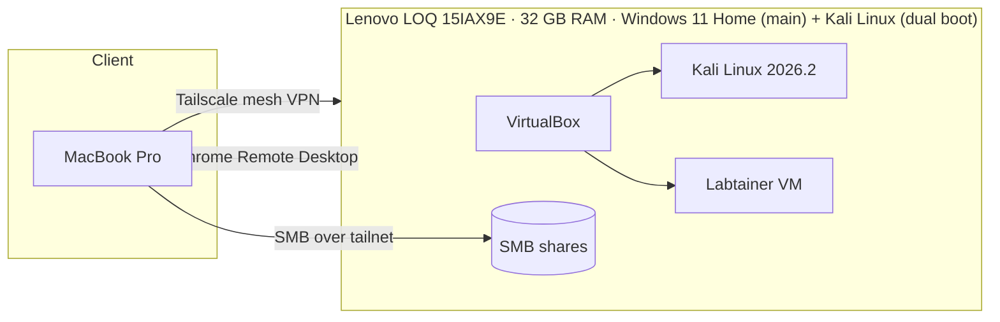

# Cybersecurity Home Lab

A personal lab I built to practice security tooling, run course labs, and test things safely outside a production network. It runs on a spare gaming laptop and I reach it remotely from my MacBook, on or off campus.

## Architecture

## Components

| Layer | Tool | Purpose |
|---|---|---|
| Host | Lenovo LOQ 15IAX9E, upgraded to 32 GB RAM | Runs several VMs at once |
| Operating systems | Windows 11 Home (main) and Kali Linux, dual boot | Windows hosts the VMs and remote access; Kali runs natively for security tools |
| Virtualization | VirtualBox | Isolated VMs for labs and testing |
| Networking | Tailscale | Private mesh VPN between my devices |
| File access | SMB | Shared folders reachable from the MacBook |
| Remote desktop | Chrome Remote Desktop | Full desktop access to the host |

## Design decisions

**Tailscale instead of port forwarding.** I wanted remote access without opening inbound ports on my home router. Tailscale builds an encrypted WireGuard tunnel between my own devices, so the lab isn't exposed to the public internet.

**Chrome Remote Desktop instead of RDP.** Windows 11 Home can't host native RDP. Rather than upgrading the OS, I used Chrome Remote Desktop for full desktop control and kept file access on SMB.

**Dual boot Kali alongside Windows.** Windows stays the main OS for daily use, VirtualBox, and remote access. I run Kali two ways: as a VirtualBox VM for course labs I can snapshot and reset, and natively through dual boot when I need full performance or direct access to the network adapter.

**Upgraded RAM before adding VMs.** Going to 32 GB lets me run an attacker VM and a target VM side by side without the host slowing down.

## Virtual machines

| VM | Used for |
|---|---|
| Kali Linux 2026.2 | Offensive security tools and course labs |
| Labtainer VM | Labtainers, the Naval Postgraduate School's Docker-based security lab framework (24 labs completed, listed below) |

## Labtainers

I've completed 24 Labtainers exercises through my cybersecurity coursework. Each lab runs in isolated containers and is graded automatically on the work done inside them, so it's hands-on practice instead of reading.

| Area | Labs completed |
|---|---|
| Network traffic and scanning | `wireshark-intro`, `tcpip`, `nmap-ssh`, `local-dns`, `telnetlab` |
| Secure remote access and authentication | `sshlab`, `ssh-tunnel`, `radius`, `pass-crack` |
| Web application attacks | `sql-inject`, `xsite` (XSS), `xforge` (CSRF) |
| Cryptography | `symkeylab`, `pubkey`, `ssl`, `onewayhash`, `macs-hash` |
| Access control and privileges | `acl`, `capabilities`, `setuid-env`, `users`, `db-access` |
| Debugging and system tracing | `gdblesson`, `strace` |

## Roadmap

- [ ] Add a SIEM (Splunk Free or Wazuh) and forward logs from the VMs
- [ ] Work through the TryHackMe SOC Level 1 path and practice on the lab
- [ ] Build an attacker/target VM pair and write up detections for each attack
- [ ] Map detections to MITRE ATT&CK techniques
- [ ] Document each lab exercise in its own writeup
