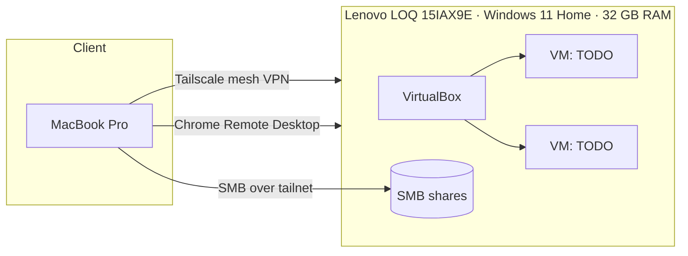

# Cybersecurity Home Lab

A personal lab I built to practice security tooling, run course labs, and test things safely outside a production network. It runs on a spare gaming laptop and I reach it remotely from my MacBook, on or off campus.

## Architecture

## Components

| Layer | Tool | Purpose |
|---|---|---|
| Host | Lenovo LOQ 15IAX9E, upgraded to 32 GB RAM | Runs several VMs at once |
| Virtualization | VirtualBox | Isolated VMs for labs and testing |
| Networking | Tailscale | Private mesh VPN between my devices |
| File access | SMB | Shared folders reachable from the MacBook |
| Remote desktop | Chrome Remote Desktop | Full desktop access to the host |

## Design decisions

**Tailscale instead of port forwarding.** I wanted remote access without opening inbound ports on my home router. Tailscale builds an encrypted WireGuard tunnel between my own devices, so the lab isn't exposed to the public internet.

**Chrome Remote Desktop instead of RDP.** Windows 11 Home can't host native RDP. Rather than upgrading the OS, I used Chrome Remote Desktop for full desktop control and kept file access on SMB.

**Upgraded RAM before adding VMs.** Going to 32 GB lets me run an attacker VM and a target VM side by side without the host slowing down.

## Virtual machines

<!-- List what you actually run. Example format: -->
| VM | OS | Used for |
|---|---|---|
| TODO | TODO | TODO |

## CTF and training practice

<!-- Only list what you've completed. Link writeups if you have any. -->
- **picoCTF:** TODO (for example, number of challenges solved or categories)
- **TryHackMe:** TODO (rooms or paths completed)
- **Hack The Box:** TODO (machines or challenges completed)

## Roadmap

- [ ] Add a SIEM (Splunk Free or Wazuh) and forward logs from the VMs
- [ ] Build an attacker/target VM pair and write up detections for each attack
- [ ] Map detections to MITRE ATT&CK techniques
- [ ] Document each lab exercise in its own writeup

## Screenshots

<!-- Add 2 or 3 screenshots. Blur Tailscale IPs, device names, and usernames first. -->
